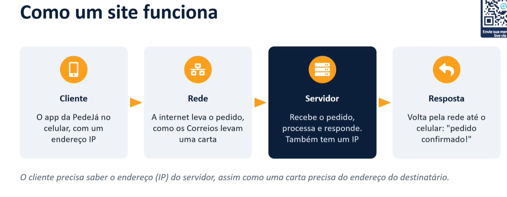

# AWS Cloud Practitioner — Domínio 1

## Conceitos de Computação em Nuvem

**Certificação:** AWS Certified Cloud Practitioner (CLF-C02)  
**Peso na prova:** 24%

---

## 1. O que é computação em nuvem?

Computação em nuvem é o fornecimento de recursos de TI sob demanda pela internet, com pagamento conforme o uso (Pay-as-you-go).

Permite utilizar servidores, armazenamento, bancos de dados e redes sem precisar adquirir e manter uma infraestrutura física própria.

> Analogia: utilizar energia elétrica sem precisar construir uma usina.

### Como um site funciona?

- O cliente (navegador) envia uma solicitação ao servidor.
- O DNS resolve o nome do domínio para um endereço IP.
- O servidor recebe e processa a solicitação.
- O servidor retorna uma resposta ao cliente.

### Do que é feito um servidor?

| Recurso | Função | Analogia: restaurante |
|---|---|---|
| CPU | Processar instruções | Cozinheiro |
| RAM | Armazenar temporariamente dados em uso | Bancada |
| Storage | Armazenar arquivos e dados | Despensa |
| Database | Organizar e consultar informações | Estoque organizado |
| Network | Permitir a comunicação | Garçons |

A RAM é volátil, enquanto o armazenamento persistente mantém os dados após o desligamento.

O banco de dados é um software ou serviço que utiliza recursos computacionais, não um componente físico.

---

## 2. CAPEX x OPEX

A computação em nuvem permite substituir grandes investimentos antecipados por despesas operacionais variáveis.

| CAPEX | OPEX |
|---|---|
| Capital Expenditure | Operational Expenditure |
| Despesas de capital | Despesas operacionais |
| Investimento antecipado | Pagamento pelo uso |
| Compra de servidores | Utilização de servidores na nuvem |
| Alto custo inicial | Menor investimento inicial |

> Analogia: CAPEX é comprar um carro. OPEX é pagar pelas viagens realizadas.

---

## 3. Os três fundamentos de precificação da AWS

| Fundamento | Cobrança |
|---|---|
| Compute | Capacidade e tempo de processamento |
| Storage | Quantidade de dados armazenados |
| Data Transfer | Transferência de dados |

### Transferência de dados

- Entrada de dados pela internet: geralmente gratuita.
- Saída de dados para a internet: pode ser cobrada.
- Transferência entre regiões: geralmente cobrada.
- Transferência entre AZs: pode ser cobrada.

As regras de cobrança variam conforme o serviço.

### Princípios de precificação

- Pay-as-you-go: pague conforme o uso.
- Save when you commit: economize ao assumir compromissos de utilização.
- Pay less by using more: determinados serviços oferecem descontos por volume.

---

## 4. As seis vantagens da computação em nuvem

1. Trocar despesas fixas por despesas variáveis: CAPEX por OPEX.
2. Beneficiar-se de grandes economias de escala: redução de custos devido ao grande volume de clientes.
3. Parar de adivinhar a capacidade: ajustar recursos conforme a demanda.
4. Aumentar a velocidade e a agilidade: provisionar recursos rapidamente.
5. Parar de gastar dinheiro operando data centers: focar no negócio.
6. Tornar-se global em minutos: implantar aplicações em diferentes regiões.

---

## 5. Conceitos fundamentais de nuvem

| Conceito | Definição |
|---|---|
| Escalabilidade | Capacidade de aumentar ou reduzir recursos |
| Elasticidade | Ajustar dinamicamente os recursos conforme a demanda |
| Alta disponibilidade | Minimizar períodos de indisponibilidade |
| Tolerância a falhas | Continuar funcionando mesmo quando componentes falham |
| Agilidade | Provisionar recursos rapidamente |
| Durabilidade | Preservar dados ao longo do tempo |
| Resiliência | Resistir e recuperar-se de falhas |
| Latência | Tempo necessário para uma comunicação ou resposta |

### Tipos de escalabilidade

- Scale Up: aumentar a capacidade de uma máquina.
- Scale Down: reduzir a capacidade de uma máquina.
- Scale Out: adicionar máquinas.
- Scale In: remover máquinas.

Escalabilidade vertical altera a capacidade da máquina.
Escalabilidade horizontal altera a quantidade de máquinas.

> Escalabilidade é a capacidade de crescer. Elasticidade é ajustar os recursos conforme a necessidade.

---

## 6. Modelos de serviços em nuvem

### IaaS — Infrastructure as a Service

Infraestrutura como serviço.

O cliente gerencia o sistema operacional, as aplicações e os dados.

Exemplo: Amazon EC2.

### PaaS — Platform as a Service

Plataforma como serviço.

O cliente concentra-se no desenvolvimento das aplicações, enquanto o provedor gerencia a plataforma subjacente.

Exemplo: AWS Elastic Beanstalk.

### SaaS — Software as a Service

Software como serviço.

O provedor disponibiliza uma aplicação pronta para utilização.

Exemplos: Gmail, Microsoft 365 e Salesforce.

| Responsabilidade | IaaS | PaaS | SaaS |
|---|---|---|---|
| Infraestrutura física | Provedor | Provedor | Provedor |
| Sistema operacional | Cliente | Provedor | Provedor |
| Plataforma | Cliente | Provedor | Provedor |
| Aplicação | Cliente | Cliente | Provedor |
| Controle do cliente | Maior | Intermediário | Menor |

O cliente continua responsável pelo uso adequado, pelos dados e pelos acessos em todos os modelos.

> Analogia:
> - IaaS: alugar uma cozinha equipada.
> - PaaS: fornecer a receita para uma cozinha que prepara a comida.
> - SaaS: receber a refeição pronta.

---

## 7. Modelos de implantação

| Modelo | Característica |
|---|---|
| Nuvem pública | Recursos disponibilizados por um provedor de nuvem |
| Nuvem privada | Infraestrutura dedicada a uma organização |
| Nuvem híbrida | Integração entre ambientes locais ou privados e a nuvem pública |

On-premises: infraestrutura mantida pela própria organização.

---

## 8. Infraestrutura global da AWS

### Regiões (Regions)

Áreas geográficas que contêm múltiplas zonas de disponibilidade.

Exemplos:

- São Paulo: sa-east-1.
- Norte da Virgínia: us-east-1.
- Oregon: us-west-2.

Quatro fatores para escolher uma região:

- Conformidade e requisitos legais.
- Proximidade dos usuários e latência.
- Disponibilidade dos serviços.
- Preço dos recursos.

### Zonas de Disponibilidade (Availability Zones — AZs)

- Compostos por um ou mais data centers.
- Fisicamente isoladas de outras AZs.
- Infraestrutura independente de energia, rede e refrigeração.
- Conectadas por redes de alta velocidade e baixa latência.

Distribuir aplicações entre múltiplas AZs aumenta a disponibilidade e a tolerância a falhas.

### Data Centers

Instalações físicas que abrigam servidores, equipamentos de rede e armazenamento.

### Edge Locations — Locais de Borda

Pontos de presença próximos aos usuários que ajudam a reduzir a latência.

Exemplo: entrega de conteúdo pelo Amazon CloudFront (CDN).

### Outros componentes

| Componente | Função |
|---|---|
| Regional Edge Cache | Camada intermediária de cache do CloudFront |
| Local Zones | Aproximar recursos computacionais dos usuários |
| AWS Wavelength | Reduzir a latência em redes de telecomunicações |

### Hierarquia da infraestrutura

Região → Zonas de Disponibilidade → Data Centers

Os locais de borda são pontos de presença distribuídos globalmente, não subdivisões das AZs.

### Multi-AZ x Multi-Region

- Multi-AZ: alta disponibilidade dentro de uma região.
- Multi-Region: recuperação de desastres, alcance global e proteção contra falhas regionais.

---

## 9. Modelo de Responsabilidade Compartilhada

### AWS — Segurança DA nuvem

Responsável pela infraestrutura que sustenta os serviços.

- Hardware físico.
- Data centers.
- Rede global.
- Virtualização.
- Segurança física.

### Cliente — Segurança NA nuvem

Responsável pela utilização segura dos serviços.

- Dados.
- Aplicações.
- Identidades e permissões IAM.
- Configurações de segurança.
- Controle de acesso.
- Configurações de criptografia.

### Exemplos

| Responsabilidade | EC2 | RDS | S3 |
|---|---|---|---|
| Hardware físico | AWS | AWS | AWS |
| Sistema operacional subjacente | Cliente | AWS | AWS |
| Controle de acesso | Cliente | Cliente | Cliente |
| Proteção dos dados do cliente | Cliente | Cliente | Cliente |

Quanto mais gerenciado for o serviço, maior será a responsabilidade operacional assumida pela AWS.

> AWS protege a infraestrutura. O cliente protege aquilo que utiliza dentro dela.

---

## 10. AWS Well-Architected Framework

Conjunto de boas práticas para projetar, construir e avaliar arquiteturas na AWS.

### Os seis pilares

| Pilar | Objetivo | Palavras-chave |
|---|---|---|
| Excelência Operacional | Operar e melhorar continuamente | Automação, monitoramento |
| Segurança | Proteger dados e sistemas | IAM, criptografia |
| Confiabilidade | Recuperar-se de falhas | Backup, disponibilidade |
| Eficiência de Performance | Utilizar recursos adequadamente | Desempenho, seleção de recursos |
| Otimização de Custos | Evitar gastos desnecessários | Rightsizing, economia |
| Sustentabilidade | Reduzir impactos ambientais | Eficiência energética |

### AWS Well-Architected Tool

Ferramenta que permite avaliar cargas de trabalho, identificar riscos e recomendar melhorias com base nos seis pilares.

---

## 11. AWS CAF — Cloud Adoption Framework

Framework que orienta organizações durante a adoção e transformação para a nuvem.

### As seis perspectivas

| Perspectiva | Foco |
|---|---|
| Business (Negócios) | Resultados e objetivos do negócio |
| People (Pessoas) | Pessoas, competências e cultura |
| Governance (Governança) | Riscos, investimentos e benefícios |
| Platform (Plataforma) | Infraestrutura e arquitetura |
| Security (Segurança) | Proteção de dados e sistemas |
| Operations (Operações) | Operação dos serviços |

### As quatro fases da transformação

| Fase | Objetivo |
|---|---|
| Envision (Visualizar) | Identificar oportunidades e resultados esperados |
| Align (Alinhar) | Identificar lacunas de capacidade e dependências |
| Launch (Lançar) | Implementar projetos piloto |
| Scale (Escalar) | Expandir iniciativas bem-sucedidas |

Fluxo: Envision → Align → Launch → Scale

### Benefícios do AWS CAF

- Reduzir riscos de negócio.
- Melhorar o desempenho ambiental, social e de governança (ESG).
- Aumentar a receita.
- Melhorar a eficiência operacional.

---

## 12. AWS CAF x Well-Architected Framework

| AWS CAF | Well-Architected Framework |
|---|---|
| Adoção da nuvem | Arquitetura na nuvem |
| Transformação organizacional | Qualidade das cargas de trabalho |
| Seis perspectivas | Seis pilares |
| Quatro fases de transformação | Boas práticas arquiteturais |

> CAF: como adotar a nuvem?
>
> Well-Architected: como construir uma boa arquitetura?

---

## 13. Estratégias de migração — Os 7 Rs

| Estratégia | Significado |
|---|---|
| Rehost | Migrar sem grandes alterações (Lift and Shift) |
| Replatform | Migrar realizando pequenas otimizações |
| Refactor | Redesenhar a aplicação para aproveitar a nuvem |
| Repurchase | Substituir por outro produto, geralmente SaaS |
| Relocate | Mover a infraestrutura sem redesenhar as aplicações |
| Retain | Manter no ambiente atual |
| Retire | Desativar aplicações desnecessárias |

### Serviços relacionados à migração

- AWS Migration Hub: acompanhar migrações.
- AWS Application Migration Service (MGN): migrar servidores.
- AWS Database Migration Service (DMS): migrar bancos de dados.
- AWS Snow Family: transferência física de dados em cenários compatíveis.

---

## 14. Economia da nuvem

### TCO — Total Cost of Ownership

Custo total de propriedade de uma infraestrutura.

Considera hardware, software, energia, manutenção, equipe e operação.

### Rightsizing

Escolher recursos com capacidade adequada à necessidade, evitando desperdícios.

### Economias de escala

Quanto maior a escala de operação da AWS, maior sua capacidade de reduzir custos e repassar economias aos clientes.

### Custos na nuvem

- Custos fixos: não variam diretamente com o consumo.
- Custos variáveis: variam conforme a utilização.
- Recursos ociosos podem gerar custos desnecessários.
- Serviços gerenciados podem reduzir custos operacionais.

---

## 15. Revisão rápida para a prova

| Palavra-chave | Conceito |
|---|---|
| Investimento antecipado | CAPEX |
| Despesas operacionais | OPEX |
| Pagamento conforme o uso | Pay-as-you-go |
| Ajuste dinâmico de recursos | Elasticidade |
| Adicionar máquinas | Scale Out |
| Aumentar capacidade de uma máquina | Scale Up |
| Infraestrutura virtual | IaaS |
| Plataforma de desenvolvimento | PaaS |
| Software pronto | SaaS |
| Área geográfica | Região |
| Data centers isolados | AZ |
| Entrega de conteúdo próxima ao usuário | Edge Location |
| Segurança DA nuvem | AWS |
| Segurança NA nuvem | Cliente |
| Seis pilares | Well-Architected Framework |
| Seis perspectivas | AWS CAF |
| Identificar lacunas de capacidade | Align |
| Lift and Shift | Rehost |
| Custo total de propriedade | TCO |
| Dimensionamento adequado | Rightsizing |

---

## Documentação oficial

- [Computação em nuvem](https://aws.amazon.com/what-is-cloud-computing/)
- [Precificação AWS](https://aws.amazon.com/pricing/)
- [Infraestrutura global](https://aws.amazon.com/about-aws/global-infrastructure/)
- [Responsabilidade compartilhada](https://aws.amazon.com/compliance/shared-responsibility-model/)
- [Well-Architected Framework](https://aws.amazon.com/architecture/well-architected/)
- [Cloud Adoption Framework](https://aws.amazon.com/cloud-adoption-framework/)
