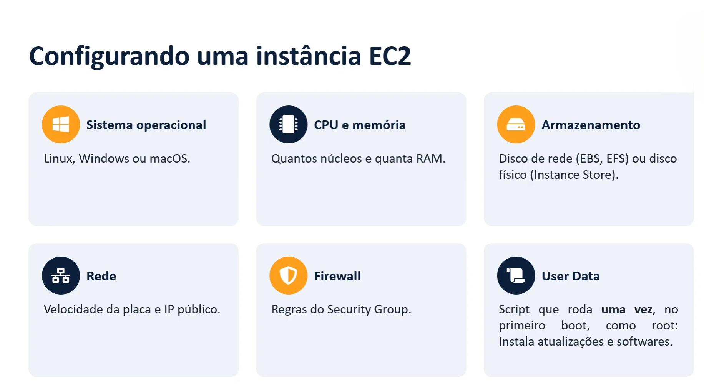
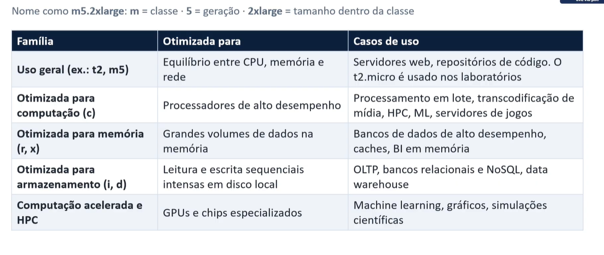
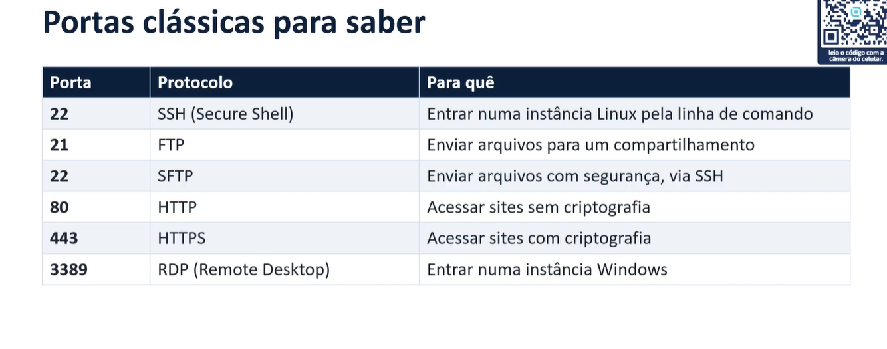
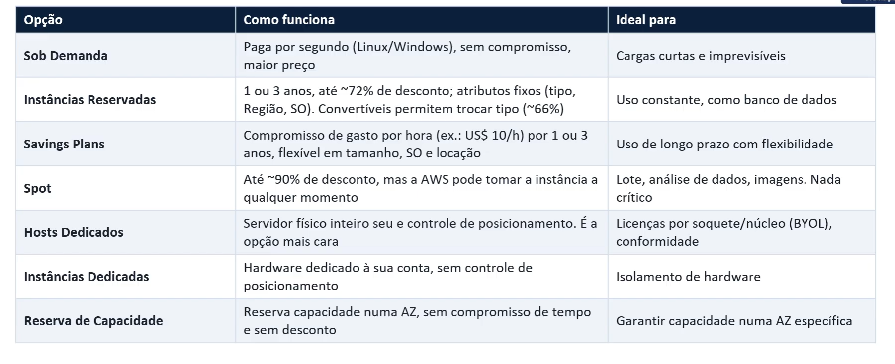
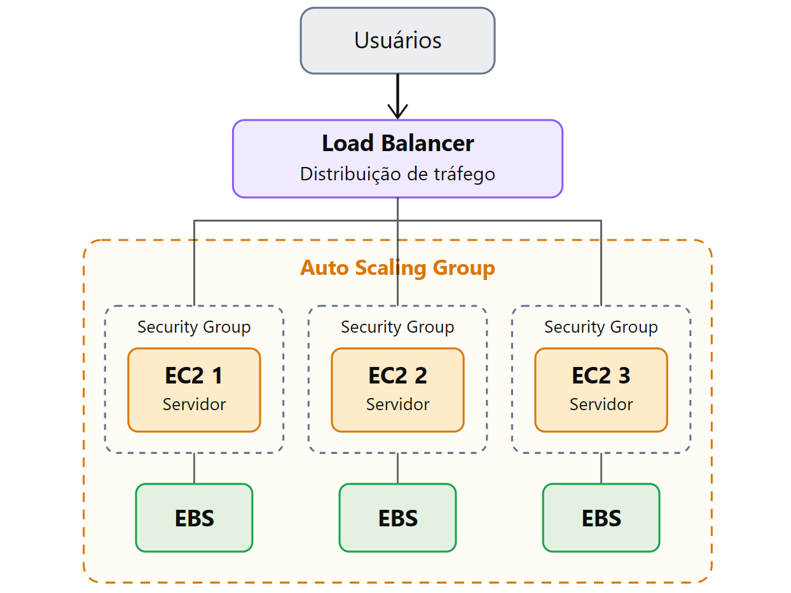

# Amazon EC2 — Elastic Compute Cloud

## 1. Visão geral

O Amazon EC2 é um dos principais serviços da AWS, responsável por fornecer capacidade computacional na nuvem.

É um serviço do modelo **IaaS (Infrastructure as a Service)**, que permite criar e gerenciar servidores virtuais sob demanda.

O ecossistema do EC2 inclui a capacidade de:

- Alugar máquinas virtuais (Amazon EC2).
- Armazenar dados em discos virtuais (Amazon EBS).
- Distribuir tráfego entre máquinas (Elastic Load Balancing).
- Escalar automaticamente os recursos (EC2 Auto Scaling).

### Configuração de uma instância EC2

Ao criar uma instância, podemos definir:

- Sistema operacional.
- Quantidade de CPU (vCPU).
- Quantidade de memória RAM.
- Tipo e capacidade de armazenamento.
- Configurações de rede.
- Security Groups.
- Key Pair (chaves de acesso).
- IAM Role.

---

## 2. Armazenamento de uma instância EC2

### EC2 Instance Store

É um armazenamento temporário, conectado fisicamente ao servidor que hospeda a instância EC2.

Características:

- Alto desempenho de leitura e escrita.
- Armazenamento efêmero (não persistente).
- Os dados são perdidos quando a instância é parada, hibernada ou terminada.
- Os dados são preservados durante uma simples reinicialização (reboot).

Indicado para dados temporários, caches e buffers.

### Amazon EBS — Elastic Block Store

É o disco de rede da instância EC2.

Fornece armazenamento em blocos persistente, permitindo que os dados sejam mantidos mesmo quando a instância é parada.

Características:

- Pode ser desanexado de uma instância e anexado a outra.
- Está vinculado a uma Zona de Disponibilidade (AZ).
- Permite a criação de snapshots (backups).
- Suporta criptografia.
- Pode ter seu tamanho aumentado.
- Possui ciclo de vida que pode ser independente da instância EC2.

A exclusão do volume ao terminar uma instância depende da configuração `DeleteOnTermination`.

| Característica | EBS | Instance Store |
|---|---|---|
| Armazenamento | Persistente | Temporário |
| Conexão | Via rede | Fisicamente conectado ao host |
| Dados após parar a instância | Preservados | Perdidos |
| Snapshots nativos | Sim | Não |

---

## 3. Security Groups — O firewall da instância

Os Security Groups funcionam como firewalls virtuais, controlando o tráfego de entrada e saída dos recursos associados.

### Características

- Controlam o tráfego de entrada (Inbound).
- Controlam o tráfego de saída (Outbound).
- Contêm apenas regras de permissão (Allow).
- Não possuem regras explícitas de negação (Deny).
- Permitem configurar portas, protocolos e endereços IPv4 e IPv6.
- Permitem referenciar outros Security Groups.
- Podem ser associados a várias instâncias.
- Atuam fora do sistema operacional da instância.
- São Stateful: o tráfego de resposta a uma comunicação permitida é automaticamente autorizado.

### Comportamento padrão

Em um Security Group recém-criado:

- Entrada: todo o tráfego é bloqueado.
- Saída: todo o tráfego é permitido.

### Portas importantes

| Porta | Protocolo | Finalidade |
|---|---|---|
| 22 | SSH | Acesso remoto ao Linux |
| 21 | FTP | Transferência de arquivos |
| 80 | HTTP | Acesso a sites |
| 443 | HTTPS | Acesso seguro a sites |
| 3389 | RDP | Acesso remoto ao Windows |
| 3306 | MySQL | Banco de dados MySQL |
| 5432 | PostgreSQL | Banco de dados PostgreSQL |

### Identificação de problemas

- **Connection Timeout:** pode indicar problemas no Security Group, NACL ou na configuração de rede.
- **Connection Refused:** pode indicar que a aplicação não está em execução ou não está escutando na porta solicitada.

> Analogia: o Security Group é o porteiro da instância, com uma lista de quem pode entrar. Quem não está na lista não chega à porta.

---

## 4. Opções de compra do EC2

A AWS oferece diferentes modelos de contratação de instâncias, de acordo com a necessidade da aplicação.

| Modelo | Característica | Indicação |
|---|---|---|
| On-Demand | Pagamento pelo uso, sem compromisso de longo prazo | Aplicações de curta duração ou imprevisíveis |
| Reserved Instances | Desconto mediante compromisso de 1 ou 3 anos | Cargas previsíveis e contínuas |
| Savings Plans | Compromisso de consumo em USD/hora por 1 ou 3 anos | Cargas contínuas com maior flexibilidade |
| Spot Instances | Capacidade ociosa com descontos de até 90% | Processamentos tolerantes a interrupções |
| Dedicated Hosts | Servidor físico dedicado ao cliente | Licenciamento e conformidade |
| Dedicated Instances | Instâncias em hardware dedicado à conta | Isolamento físico |
| Capacity Reservations | Reserva de capacidade em uma AZ específica | Garantia de capacidade computacional |

### Pontos importantes

- **On-Demand:** não exige compromisso de longo prazo.
- **Spot:** pode ser interrompida pela AWS quando a capacidade for necessária.
- **Reserved Instances:** oferece desconto para cargas previsíveis.
- **Savings Plans:** oferece descontos mediante compromisso de consumo.
- **Capacity Reservations:** garante capacidade, mas não oferece desconto automaticamente.

---

## 5. Modelo de Responsabilidade Compartilhada

No Amazon EC2, a segurança é uma responsabilidade compartilhada entre a AWS e o cliente.

### AWS — Segurança DA nuvem

A AWS é responsável por:

- Infraestrutura física.
- Segurança da rede global.
- Segurança dos data centers.
- Isolamento nos hosts físicos.
- Substituição de hardware com defeito.
- Infraestrutura de virtualização.
- Conformidade da infraestrutura sob sua responsabilidade.

### Cliente — Segurança NA nuvem

O cliente é responsável por:

- Configuração dos Security Groups.
- Patches e atualizações do sistema operacional.
- Softwares instalados na instância.
- Configuração das IAM Roles.
- Gerenciamento do acesso dos usuários.
- Segurança e criptografia dos dados.
- Configuração e manutenção das aplicações.

> A AWS protege a infraestrutura. O cliente protege aquilo que executa dentro dela.

---

## 6. AMI — Amazon Machine Image

Uma AMI é uma imagem utilizada como modelo para a criação de instâncias EC2.

Pode conter:

- Sistema operacional.
- Softwares instalados.
- Configurações personalizadas.
- Aplicações.
- Informações sobre os volumes de armazenamento.

### Benefícios

- Padronização de ambientes.
- Agilidade na criação de instâncias.
- Reutilização de configurações.
- Redução de configurações manuais.

As AMIs são específicas de uma região, mas podem ser copiadas para outras regiões.

> Analogia: a AMI é a forma do bolo. Depois de pronta, cada nova instância pode ser criada com a mesma configuração inicial, sem precisar refazer toda a receita.

---

## 7. Key Pair — Chaves de acesso

Um Key Pair é um par de chaves criptográficas utilizado para autenticação e acesso seguro às instâncias EC2.

É composto por:

- **Chave pública:** disponibilizada na instância.
- **Chave privada:** mantida pelo usuário.

No Linux, pode ser utilizado para acessar a instância via SSH.

No Windows, pode ser utilizado para descriptografar a senha inicial do administrador.

A chave privada nunca deve ser compartilhada ou enviada ao GitHub.

---

## 8. Elastic Load Balancing (ELB)

Serviço responsável por distribuir automaticamente o tráfego entre múltiplos destinos, como instâncias EC2.

### Benefícios

- Alta disponibilidade.
- Tolerância a falhas.
- Distribuição de carga.
- Verificação da integridade dos destinos (Health Checks).

### Tipos de Load Balancer

| Tipo | Camada | Utilização |
|---|---|---|
| Application Load Balancer (ALB) | 7 | HTTP e HTTPS |
| Network Load Balancer (NLB) | 4 | TCP, UDP e TLS |
| Gateway Load Balancer (GWLB) | 3 | Appliances virtuais de rede e segurança |
| Classic Load Balancer (CLB) | 4 e 7 | Geração anterior de balanceadores |

---

## 9. EC2 Auto Scaling

Serviço responsável por ajustar automaticamente a quantidade de instâncias EC2 de acordo com a demanda.

### Conceitos importantes

- **Minimum Capacity:** quantidade mínima de instâncias.
- **Desired Capacity:** quantidade desejada de instâncias.
- **Maximum Capacity:** quantidade máxima de instâncias.
- **Scale Out:** adicionar instâncias.
- **Scale In:** remover instâncias.

### Benefícios

- Elasticidade.
- Alta disponibilidade.
- Otimização de custos.
- Substituição automática de instâncias não saudáveis.

---

## 10. Resumo para a certificação Cloud Practitioner

| Serviço ou recurso | Função principal |
|---|---|
| EC2 | Servidores virtuais |
| EBS | Armazenamento persistente em blocos |
| Instance Store | Armazenamento temporário |
| AMI | Modelo para criação de instâncias |
| Security Group | Firewall virtual Stateful |
| Key Pair | Autenticação segura |
| ELB | Distribuição de tráfego |
| Auto Scaling | Ajuste automático de capacidade |
| Spot Instances | Economia em cargas tolerantes a interrupções |
| Dedicated Hosts | Servidor físico dedicado |

---

## Documentação oficial

- [Amazon EC2](https://aws.amazon.com/ec2/)
- [Amazon EBS](https://aws.amazon.com/ebs/)
- [Elastic Load Balancing](https://aws.amazon.com/elasticloadbalancing/)
- [EC2 Auto Scaling](https://aws.amazon.com/ec2/autoscaling/)
- [Modelo de Responsabilidade Compartilhada](https://aws.amazon.com/compliance/shared-responsibility-model/)

