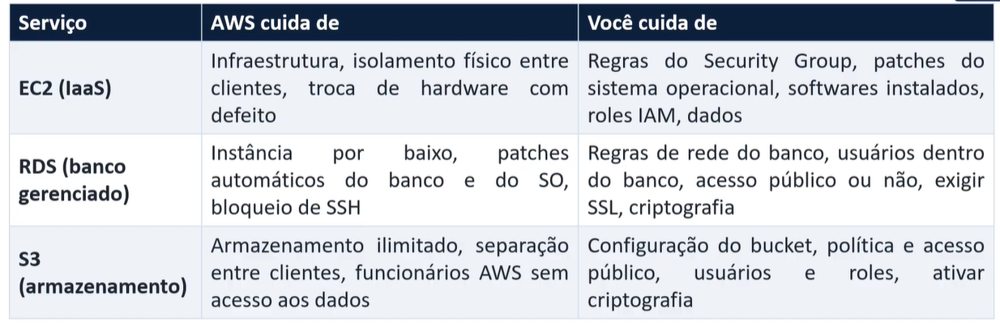
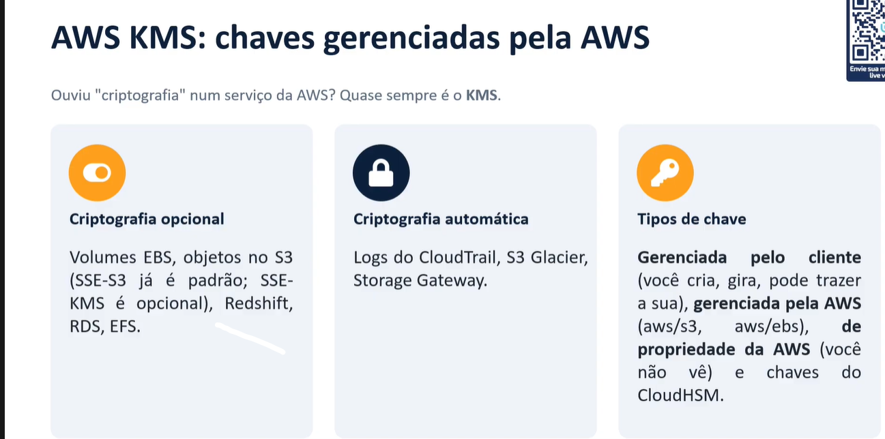
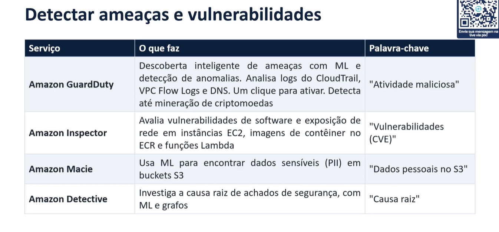
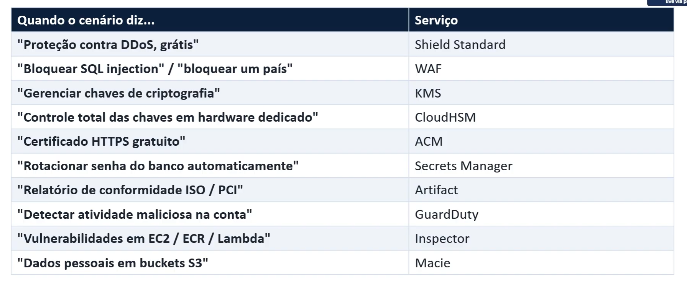

# Segurança e Conformidade: Domínio 2 🔐

## 1. IAM — Identity and Access Management

O IAM controla **quem pode acessar os recursos da AWS e quais ações pode realizar**.

- **User:** identidade de um usuário ou aplicação. Para pessoas, prefira acesso federado com credenciais temporárias.
- **Group:** conjunto de usuários IAM que compartilham permissões.
- **Policy:** documento, geralmente em JSON, que define permissões. Pode permitir (`Allow`) ou negar (`Deny`) ações sobre recursos.
- **Role:** identidade que pode ser assumida temporariamente por usuários, serviços AWS ou identidades federadas. Não possui senha nem access keys permanentes.

### Políticas e menor privilégio

Uma política pode especificar `Effect` (Allow/Deny), `Action` (ação), `Resource` (recurso) e `Condition` (condição opcional).

**Princípio do menor privilégio:** conceder somente as permissões necessárias para executar uma tarefa. Por padrão, o acesso é negado; um `Deny` explícito prevalece sobre um `Allow`.

### Três formas comuns de acessar a AWS

| Forma | Uso |
|---|---|
| AWS Management Console | Interface gráfica no navegador |
| AWS CLI | Comandos no terminal |
| AWS SDKs | Código em linguagens como Python e Java |

### Segurança e auditoria do IAM

- **MFA:** exige um fator adicional de autenticação.
- **Credential Report:** relatório das credenciais dos usuários IAM da conta.
- **Last Accessed:** mostra informações sobre o último acesso a serviços ou ações, ajudando a revisar permissões.
- **Boas práticas:** proteger o root com MFA, não usá-lo no dia a dia, preferir credenciais temporárias, aplicar menor privilégio e nunca colocar credenciais no GitHub.

## 2. Identidade avançada

| Serviço | Para que serve |
|---|---|
| AWS STS | Fornece credenciais de segurança temporárias |
| Amazon Cognito | Autenticação e acesso de usuários de aplicações web e mobile |
| AWS Directory Service | Integração e serviços de diretório, como Microsoft Active Directory |
| IAM Identity Center | Acesso centralizado da força de trabalho a contas AWS e aplicações |

**IAM x Cognito:** IAM controla o acesso a recursos AWS; Cognito é voltado às identidades dos usuários da sua aplicação. O Cognito também pode permitir acesso temporário a recursos AWS por meio de identity pools.

## 3. Modelo de responsabilidade compartilhada

- **AWS — segurança DA nuvem:** instalações físicas, hardware, rede e infraestrutura que executa os serviços.
- **Cliente — segurança NA nuvem:** dados, identidades, permissões e configurações sob seu controle.

| Exemplo | Responsabilidade do cliente |
|---|---|
| EC2 | Atualizar o sistema operacional convidado, configurar Security Groups e proteger aplicações e dados |
| RDS | Gerenciar dados, acessos e configurações; a AWS gerencia a infraestrutura e tarefas do sistema operacional |
| S3 | Configurar permissões, proteger dados e definir opções de segurança adequadas |

**Dica de prova:** quanto mais gerenciado o serviço, menos infraestrutura você administra. Isso não elimina sua responsabilidade pelos dados e acessos.

## 4. Proteção de rede e aplicação

**DDoS:** ataque que tenta indisponibilizar um serviço por meio de um grande volume de tráfego.

| Serviço | Função principal |
|---|---|
| Shield Standard | Proteção DDoS básica, automática e sem custo adicional |
| Shield Advanced | Proteção DDoS aprimorada e recursos adicionais de resposta; pago |
| AWS WAF | Filtra requisições HTTP/HTTPS, incluindo padrões de SQL injection e XSS |
| CloudFront | CDN que entrega conteúdo na borda e pode ajudar a absorver tráfego |
| Route 53 | DNS altamente disponível e resiliente |
| Auto Scaling | Ajusta a capacidade conforme a demanda; não substitui proteção DDoS |

### Firewalls da AWS

- **Security Group:** controla tráfego de interfaces de rede de recursos, como EC2. É *stateful* e possui apenas regras de permissão.
- **Network ACL:** controla tráfego de entrada e saída da sub-rede. É *stateless* e aceita regras Allow e Deny.
- **AWS WAF:** firewall de aplicações web.
- **AWS Network Firewall:** inspeção e filtragem gerenciada de tráfego de rede em VPCs.
- **AWS Firewall Manager:** centraliza a administração de políticas de firewall em várias contas e recursos.

### Pentest

A AWS permite testes de invasão em determinados serviços sem aprovação prévia, desde que respeitem sua política de testes. Não presuma que todos os serviços ou tipos de teste são permitidos. Simulações de DDoS seguem regras específicas.

## 5. Criptografia e segredos

- **Em repouso (at rest):** dados armazenados, como objetos no S3 ou volumes EBS.
- **Em trânsito (in transit):** dados trafegando entre sistemas, protegidos, por exemplo, por TLS/HTTPS.

### AWS KMS x AWS CloudHSM

| KMS | CloudHSM |
|---|---|
| Serviço gerenciado de chaves criptográficas | HSMs dedicados ao cliente |
| Integração simples com diversos serviços AWS | Maior controle sobre chaves e operações criptográficas |
| Suporta chaves gerenciadas pela AWS e pelo cliente | Cliente administra o ambiente criptográfico do HSM |

### Certificados, segredos e conformidade

- **AWS Certificate Manager (ACM):** provisiona e gerencia certificados TLS/SSL para serviços integrados.
- **AWS Secrets Manager:** armazena e gerencia segredos, como senhas de bancos de dados; oferece rotação para cenários compatíveis.
- **AWS Artifact:** disponibiliza relatórios de conformidade da AWS e determinados acordos.

## 6. Detecção de ameaças e vulnerabilidades

| Serviço | Palavra-chave para a prova |
|---|---|
| Amazon GuardDuty | Detectar ameaças e atividades suspeitas |
| Amazon Inspector | Encontrar vulnerabilidades em workloads compatíveis, como EC2, imagens ECR e Lambda |
| Amazon Macie | Descobrir dados sensíveis no S3 |
| Amazon Detective | Investigar e analisar possíveis incidentes de segurança |

**Memorize:** GuardDuty detecta; Inspector procura vulnerabilidades; Macie encontra dados sensíveis; Detective ajuda a investigar.

## 7. Auditoria, conformidade e visão centralizada

| Serviço | Quando escolher |
|---|---|
| AWS CloudTrail | Saber quem realizou uma ação de API, quando e de onde |
| AWS Config | Registrar configurações de recursos e avaliar conformidade com regras |
| AWS Security Hub | Centralizar e priorizar descobertas de segurança e avaliar controles |
| IAM Access Analyzer | Analisar políticas e identificar acessos externos, internos ou não utilizados, conforme o tipo de análise |
| AWS Trust & Safety / Abuse | Reportar suspeitas de abuso envolvendo recursos AWS |

### Comparações que merecem revisão

- **CloudTrail x Config:** histórico de ações x histórico e avaliação de configurações.
- **CloudWatch x CloudTrail:** métricas, logs e alarmes operacionais x auditoria de atividades.
- **GuardDuty x Security Hub:** detecção de ameaças x visão centralizada de segurança.
- **Artifact x Config:** documentos de conformidade da AWS x conformidade das configurações dos seus recursos.
- **Secrets Manager x KMS:** armazenar segredos x gerenciar chaves criptográficas.
