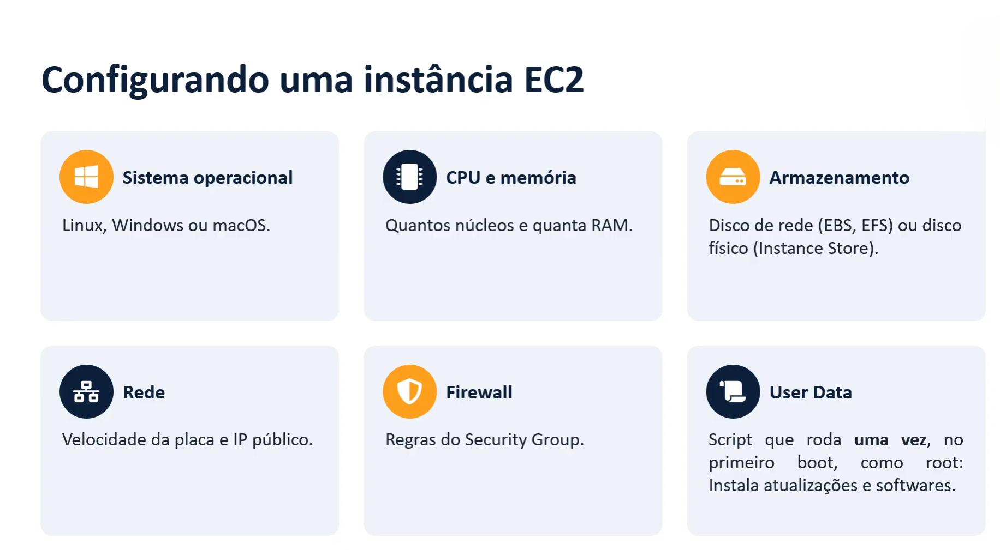
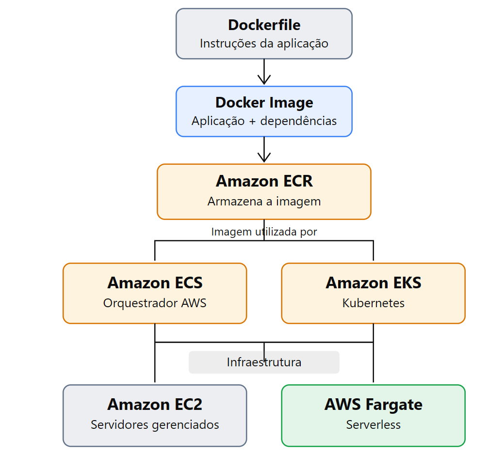
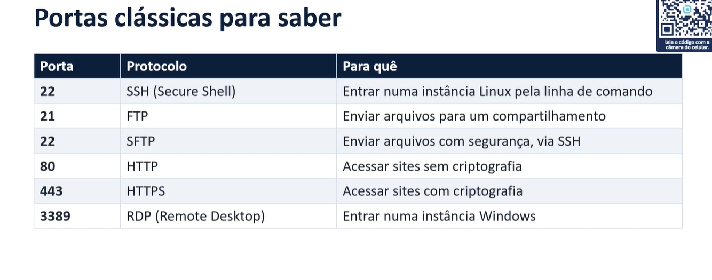
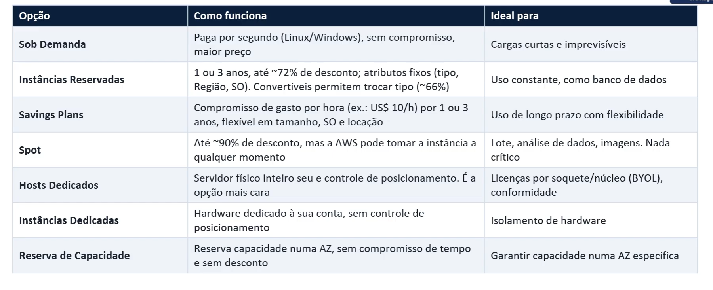
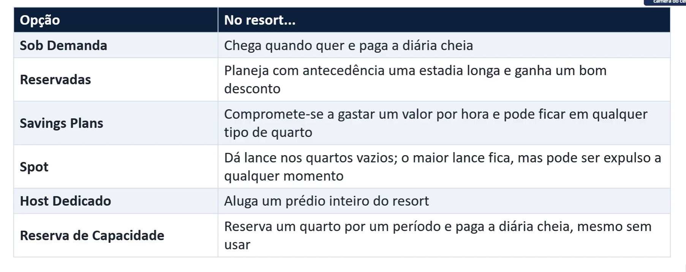
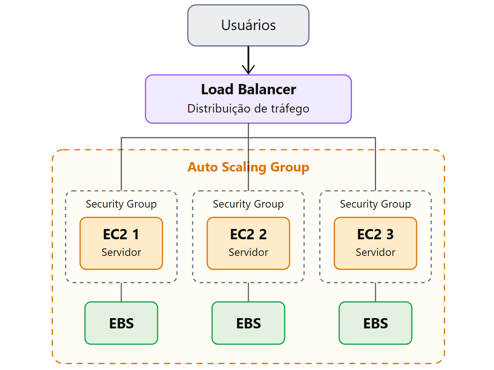

# AWS — Serviços de Computação

## Domínio 3 — Tecnologia e Serviços de Nuvem

Material de estudo para a certificação AWS Certified Cloud Practitioner (CLF-C02).

Este domínio representa 34% da prova e aborda os principais serviços e tecnologias disponíveis na AWS.

### Conteúdos abordados

- Amazon EC2
- Amazon EBS
- EC2 Instance Store
- Security Groups
- Amazon Machine Image (AMI)
- Elastic Load Balancing (ELB)
- EC2 Auto Scaling
- AWS Lambda
- Contêineres e Docker
- Amazon ECS
- Amazon EKS
- AWS Fargate
- Amazon ECR

# Amazon EC2 — Elastic Compute Cloud

## 1. Visão geral

O Amazon EC2 é um dos principais serviços da AWS, responsável por fornecer capacidade computacional na nuvem.

É um serviço do modelo **IaaS (Infrastructure as a Service)**, que permite criar e gerenciar servidores virtuais sob demanda.

O ecossistema do EC2 inclui a capacidade de:

- Alugar máquinas virtuais (Amazon EC2).
- Armazenar dados em discos virtuais (Amazon EBS).
- Distribuir tráfego entre máquinas (Elastic Load Balancing).
- Escalar automaticamente os recursos (EC2 Auto Scaling).

### Configuração de uma instância EC2

Ao criar uma instância, podemos definir:

- Sistema operacional.
- Quantidade de CPU (vCPU).
- Quantidade de memória RAM.
- Tipo e capacidade de armazenamento.
- Configurações de rede.
- Security Groups.
- Key Pair (chaves de acesso).
- IAM Role.

---

## 2. Armazenamento de uma instância EC2

### EC2 Instance Store

É um armazenamento temporário, conectado fisicamente ao servidor que hospeda a instância EC2.

Características:

- Alto desempenho de leitura e escrita.
- Armazenamento efêmero (não persistente).
- Os dados são perdidos quando a instância é parada, hibernada ou terminada.
- Os dados são preservados durante uma simples reinicialização (reboot).

Indicado para dados temporários, caches e buffers.

### Amazon EBS — Elastic Block Store

É o disco de rede da instância EC2.

Fornece armazenamento em blocos persistente, permitindo que os dados sejam mantidos mesmo quando a instância é parada.

Características:

- Pode ser desanexado de uma instância e anexado a outra.
- Está vinculado a uma Zona de Disponibilidade (AZ).
- Permite a criação de snapshots (backups).
- Suporta criptografia.
- Pode ter seu tamanho aumentado.
- Possui ciclo de vida que pode ser independente da instância EC2.

A exclusão do volume ao terminar uma instância depende da configuração `DeleteOnTermination`.

| Característica | EBS | Instance Store |
|---|---|---|
| Armazenamento | Persistente | Temporário |
| Conexão | Via rede | Fisicamente conectado ao host |
| Dados após parar a instância | Preservados | Perdidos |
| Snapshots nativos | Sim | Não |

---

## 3. Security Groups — O firewall da instância

Os Security Groups funcionam como firewalls virtuais, controlando o tráfego de entrada e saída dos recursos associados.

### Características

- Controlam o tráfego de entrada (Inbound).
- Controlam o tráfego de saída (Outbound).
- Contêm apenas regras de permissão (Allow).
- Não possuem regras explícitas de negação (Deny).
- Permitem configurar portas, protocolos e endereços IPv4 e IPv6.
- Permitem referenciar outros Security Groups.
- Podem ser associados a várias instâncias.
- Atuam fora do sistema operacional da instância.
- São Stateful: o tráfego de resposta a uma comunicação permitida é automaticamente autorizado.

### Comportamento padrão

Em um Security Group recém-criado:

- Entrada: todo o tráfego é bloqueado.
- Saída: todo o tráfego é permitido.

### Portas importantes

| Porta | Protocolo | Finalidade |
|---|---|---|
| 22 | SSH | Acesso remoto ao Linux |
| 21 | FTP | Transferência de arquivos |
| 80 | HTTP | Acesso a sites |
| 443 | HTTPS | Acesso seguro a sites |
| 3389 | RDP | Acesso remoto ao Windows |
| 3306 | MySQL | Banco de dados MySQL |
| 5432 | PostgreSQL | Banco de dados PostgreSQL |

### Identificação de problemas

- **Connection Timeout:** pode indicar problemas no Security Group, NACL ou na configuração de rede.
- **Connection Refused:** pode indicar que a aplicação não está em execução ou não está escutando na porta solicitada.

> Analogia: o Security Group é o porteiro da instância, com uma lista de quem pode entrar. Quem não está na lista não chega à porta.

---

## 4. Opções de compra do EC2

A AWS oferece diferentes modelos de contratação de instâncias, de acordo com a necessidade da aplicação.

| Modelo | Característica | Indicação |
|---|---|---|
| On-Demand | Pagamento pelo uso, sem compromisso de longo prazo | Aplicações de curta duração ou imprevisíveis |
| Reserved Instances | Desconto mediante compromisso de 1 ou 3 anos | Cargas previsíveis e contínuas |
| Savings Plans | Compromisso de consumo em USD/hora por 1 ou 3 anos | Cargas contínuas com maior flexibilidade |
| Spot Instances | Capacidade ociosa com descontos de até 90% | Processamentos tolerantes a interrupções |
| Dedicated Hosts | Servidor físico dedicado ao cliente | Licenciamento e conformidade |
| Dedicated Instances | Instâncias em hardware dedicado à conta | Isolamento físico |
| Capacity Reservations | Reserva de capacidade em uma AZ específica | Garantia de capacidade computacional |

### Pontos importantes

- **On-Demand:** não exige compromisso de longo prazo.
- **Spot:** pode ser interrompida pela AWS quando a capacidade for necessária.
- **Reserved Instances:** oferece desconto para cargas previsíveis.
- **Savings Plans:** oferece descontos mediante compromisso de consumo.
- **Capacity Reservations:** garante capacidade, mas não oferece desconto automaticamente.

---

## 5. Modelo de Responsabilidade Compartilhada

No Amazon EC2, a segurança é uma responsabilidade compartilhada entre a AWS e o cliente.

### AWS — Segurança DA nuvem

A AWS é responsável por:

- Infraestrutura física.
- Segurança da rede global.
- Segurança dos data centers.
- Isolamento nos hosts físicos.
- Substituição de hardware com defeito.
- Infraestrutura de virtualização.
- Conformidade da infraestrutura sob sua responsabilidade.

### Cliente — Segurança NA nuvem

O cliente é responsável por:

- Configuração dos Security Groups.
- Patches e atualizações do sistema operacional.
- Softwares instalados na instância.
- Configuração das IAM Roles.
- Gerenciamento do acesso dos usuários.
- Segurança e criptografia dos dados.
- Configuração e manutenção das aplicações.

> A AWS protege a infraestrutura. O cliente protege aquilo que executa dentro dela.

---

## 6. AMI — Amazon Machine Image

Uma AMI é uma imagem utilizada como modelo para a criação de instâncias EC2.

Pode conter:

- Sistema operacional.
- Softwares instalados.
- Configurações personalizadas.
- Aplicações.
- Informações sobre os volumes de armazenamento.

### Benefícios

- Padronização de ambientes.
- Agilidade na criação de instâncias.
- Reutilização de configurações.
- Redução de configurações manuais.

As AMIs são específicas de uma região, mas podem ser copiadas para outras regiões.

> Analogia: a AMI é a forma do bolo. Depois de pronta, cada nova instância pode ser criada com a mesma configuração inicial, sem precisar refazer toda a receita.

---

## 7. Key Pair — Chaves de acesso

Um Key Pair é um par de chaves criptográficas utilizado para autenticação e acesso seguro às instâncias EC2.

É composto por:

- **Chave pública:** disponibilizada na instância.
- **Chave privada:** mantida pelo usuário.

No Linux, pode ser utilizado para acessar a instância via SSH.

No Windows, pode ser utilizado para descriptografar a senha inicial do administrador.

A chave privada nunca deve ser compartilhada ou enviada ao GitHub.

---

## 8. Elastic Load Balancing (ELB)

Serviço responsável por distribuir automaticamente o tráfego entre múltiplos destinos, como instâncias EC2.

### Benefícios

- Alta disponibilidade.
- Tolerância a falhas.
- Distribuição de carga.
- Verificação da integridade dos destinos (Health Checks).

### Tipos de Load Balancer

| Tipo | Camada | Utilização |
|---|---|---|
| Application Load Balancer (ALB) | 7 | HTTP e HTTPS |
| Network Load Balancer (NLB) | 4 | TCP, UDP e TLS |
| Gateway Load Balancer (GWLB) | 3 | Appliances virtuais de rede e segurança |
| Classic Load Balancer (CLB) | 4 e 7 | Geração anterior de balanceadores |

---

## 9. EC2 Auto Scaling

Serviço responsável por ajustar automaticamente a quantidade de instâncias EC2 de acordo com a demanda.

### Conceitos importantes

- **Minimum Capacity:** quantidade mínima de instâncias.
- **Desired Capacity:** quantidade desejada de instâncias.
- **Maximum Capacity:** quantidade máxima de instâncias.
- **Scale Out:** adicionar instâncias.
- **Scale In:** remover instâncias.

### Benefícios

- Elasticidade.
- Alta disponibilidade.
- Otimização de custos.
- Substituição automática de instâncias não saudáveis.

---

## 10. Resumo para a certificação Cloud Practitioner

| Serviço ou recurso | Função principal |
|---|---|
| EC2 | Servidores virtuais |
| EBS | Armazenamento persistente em blocos |
| Instance Store | Armazenamento temporário |
| AMI | Modelo para criação de instâncias |
| Security Group | Firewall virtual Stateful |
| Key Pair | Autenticação segura |
| ELB | Distribuição de tráfego |
| Auto Scaling | Ajuste automático de capacidade |
| Spot Instances | Economia em cargas tolerantes a interrupções |
| Dedicated Hosts | Servidor físico dedicado |

---

## Documentação oficial

- [Amazon EC2](https://aws.amazon.com/ec2/)
- [Amazon EBS](https://aws.amazon.com/ebs/)
- [Elastic Load Balancing](https://aws.amazon.com/elasticloadbalancing/)
- [EC2 Auto Scaling](https://aws.amazon.com/ec2/autoscaling/)
- [Modelo de Responsabilidade Compartilhada](https://aws.amazon.com/compliance/shared-responsibility-model/)

---

## 10. AWS Lambda — Computação Serverless

O AWS Lambda é um serviço de computação que permite executar código sem precisar provisionar ou gerenciar servidores.

É um serviço do modelo FaaS (Function as a Service).

### Características

- Não é necessário gerenciar servidores.
- Escalabilidade automática.
- Execução orientada a eventos (Event-driven).
- Pagamento baseado nas solicitações e no tempo de execução, entre outros recursos utilizados.
- Tempo máximo de execução de 15 minutos por invocação.
- Integração com diversos serviços da AWS.

### Exemplos de gatilhos (Triggers)

- Upload de um arquivo no Amazon S3.
- Requisição recebida pelo Amazon API Gateway.
- Mensagem recebida no Amazon SQS.
- Eventos do Amazon EventBridge.
- Alterações capturadas pelo DynamoDB Streams.

### Exemplo prático

1. Um arquivo CSV é enviado para um bucket S3.
2. O evento de criação do objeto aciona uma função Lambda.
3. A função executa um código Python para processar os dados.
4. O resultado é armazenado em outro bucket S3.

### Quando utilizar?

- Processamento de arquivos.
- Automação de tarefas.
- APIs serverless.
- Processamento de eventos.
- Processamentos de curta duração.

> Analogia: o Lambda é como contratar um profissional apenas quando existe uma tarefa. Ele executa o trabalho e você paga pela execução, sem precisar mantê-lo disponível o tempo todo.

### EC2 x Lambda

| Característica | EC2 | Lambda |
|---|---|---|
| Gerenciamento de servidores | Cliente | AWS |
| Sistema operacional | Gerenciado pelo cliente | Gerenciado pela AWS |
| Escalabilidade | Configurável | Automática |
| Tempo de execução | Sem limite fixo do serviço | Até 15 minutos por invocação |
| Cobrança | Capacidade provisionada e utilizada | Solicitações e execução |
| Modelo | IaaS | FaaS |
| Indicação | Aplicações contínuas | Funções orientadas a eventos |

---

## 11. Contêineres

Um contêiner é uma unidade que empacota uma aplicação e suas dependências, permitindo que ela seja executada de maneira consistente em diferentes ambientes.

Os contêineres compartilham o kernel do sistema operacional do host, sem precisar incluir um sistema operacional completo para cada aplicação.

### Benefícios

- Portabilidade.
- Padronização de ambientes.
- Isolamento de aplicações.
- Inicialização rápida.
- Melhor aproveitamento dos recursos computacionais.
- Facilidade de implantação.

### Máquinas virtuais x Contêineres

| Característica | Máquina virtual | Contêiner |
|---|---|---|
| Sistema operacional | Possui seu próprio SO | Compartilha o kernel do host |
| Consumo de recursos | Geralmente maior | Geralmente menor |
| Inicialização | Geralmente mais lenta | Geralmente mais rápida |
| Isolamento | Virtualização de hardware | Isolamento de processos |
| Portabilidade | Menor | Maior |

> Analogia: uma máquina virtual é como uma casa independente. Um contêiner é como um apartamento que possui seu próprio espaço, mas compartilha a infraestrutura do prédio.

---

## 12. Docker

Docker é uma plataforma utilizada para criar, distribuir e executar aplicações em contêineres.

### Conceitos importantes

- **Dockerfile:** arquivo com instruções para construir uma imagem.
- **Docker Image:** modelo que contém a aplicação e suas dependências.
- **Docker Container:** instância em execução de uma imagem.
- **Docker Registry:** repositório utilizado para armazenar imagens.

### Fluxo de funcionamento

Dockerfile → Docker Image → Docker Container

> A imagem é a receita pronta. O contêiner é a aplicação executada a partir dessa imagem.

---

## 13. Orquestração de contêineres

A orquestração é o gerenciamento automatizado de contêineres.

Permite:

- Implantar contêineres.
- Distribuir aplicações entre servidores.
- Escalar aplicações.
- Monitorar a integridade dos contêineres.
- Substituir contêineres com falhas.
- Gerenciar a comunicação entre aplicações.

Na AWS, os principais serviços de orquestração são Amazon ECS e Amazon EKS.

---

## 14. Amazon ECS — Elastic Container Service

Serviço gerenciado de orquestração de contêineres desenvolvido pela AWS.

Permite executar, gerenciar e escalar aplicações em contêineres.

### Opções de infraestrutura

- **Amazon EC2:** os contêineres são executados em instâncias EC2 gerenciadas pelo cliente.
- **AWS Fargate:** os contêineres são executados sem que o cliente precise gerenciar servidores.

### Quando utilizar?

- Aplicações em contêineres.
- Arquiteturas de microsserviços.
- Aplicações integradas ao ecossistema AWS.

> ECS é o orquestrador nativo da AWS.

---

## 15. Amazon EKS — Elastic Kubernetes Service

Serviço gerenciado que permite executar Kubernetes na AWS.

Kubernetes é uma plataforma de código aberto utilizada para automatizar a implantação, o gerenciamento e a escalabilidade de aplicações em contêineres.

O EKS gerencia o plano de controle do Kubernetes.

As aplicações podem utilizar diferentes opções de infraestrutura, incluindo:

- Amazon EC2.
- AWS Fargate.

### Quando utilizar?

- Aplicações que já utilizam Kubernetes.
- Arquiteturas de microsserviços.
- Ambientes que precisam de portabilidade entre plataformas.

> EKS é o serviço gerenciado de Kubernetes da AWS.

### ECS x EKS

| Característica | ECS | EKS |
|---|---|---|
| Orquestrador | Nativo da AWS | Kubernetes |
| Complexidade | Geralmente menor | Geralmente maior |
| Integração com AWS | Nativa | Nativa |
| Infraestrutura | EC2 ou Fargate, entre outras opções | EC2 ou Fargate, entre outras opções |
| Portabilidade do orquestrador | Menor | Maior |

---

## 16. AWS Fargate

AWS Fargate é um mecanismo de computação serverless para contêineres.

Permite executar contêineres sem precisar provisionar ou gerenciar instâncias EC2.

### Características

- Não exige gerenciamento de servidores.
- Integração com Amazon ECS e Amazon EKS.
- O cliente define os recursos necessários, como CPU e memória.
- A AWS gerencia a infraestrutura subjacente.
- Cobrança baseada nos recursos solicitados e no tempo de execução.

### Atenção

O Fargate não é um orquestrador de contêineres.

- ECS e EKS: gerenciam e orquestram os contêineres.
- Fargate: fornece a capacidade computacional para executá-los.

> Analogia: ECS e EKS são os gerentes que organizam o trabalho. Fargate fornece a infraestrutura onde o trabalho acontece.

---

## 17. Amazon ECR — Elastic Container Registry

Serviço gerenciado utilizado para armazenar, gerenciar e distribuir imagens de contêineres.

### Características

- Armazenamento de imagens de contêineres.
- Repositórios públicos e privados.
- Integração com ECS e EKS.
- Controle de acesso por meio do IAM.
- Suporte à verificação de vulnerabilidades nas imagens.

### Exemplo de fluxo

1. O desenvolvedor cria um Dockerfile.
2. Uma imagem Docker é construída.
3. A imagem é enviada ao Amazon ECR.
4. O ECS ou EKS utiliza a imagem armazenada.
5. O contêiner é executado utilizando EC2 ou Fargate.

> ECR armazena imagens. ECS e EKS orquestram contêineres. EC2 e Fargate fornecem capacidade computacional.

---

## 18. Resumo dos serviços de computação

| Serviço | Função principal |
|---|---|
| Amazon EC2 | Executar máquinas virtuais |
| AWS Lambda | Executar funções sem gerenciar servidores |
| Amazon ECS | Orquestrar contêineres com tecnologia nativa da AWS |
| Amazon EKS | Executar Kubernetes gerenciado |
| AWS Fargate | Executar contêineres sem gerenciar servidores |
| Amazon ECR | Armazenar imagens de contêineres |
| Amazon EBS | Armazenamento persistente em blocos |
| Elastic Load Balancing | Distribuir tráfego |
| EC2 Auto Scaling | Ajustar a quantidade de instâncias EC2 |

---

## 19. Pontos de atenção para a prova CLF-C02

- Precisa de controle sobre o sistema operacional? Amazon EC2.
- Precisa executar código em resposta a eventos? AWS Lambda.
- Precisa orquestrar contêineres com tecnologia nativa da AWS? Amazon ECS.
- Precisa utilizar Kubernetes? Amazon EKS.
- Precisa executar contêineres sem gerenciar servidores? AWS Fargate.
- Precisa armazenar imagens Docker? Amazon ECR.
- Precisa distribuir tráfego entre servidores? Elastic Load Balancing.
- Precisa ajustar automaticamente a quantidade de instâncias? EC2 Auto Scaling.

---

## Documentação oficial

- [Amazon EC2](https://aws.amazon.com/ec2/)
- [AWS Lambda](https://aws.amazon.com/lambda/)
- [Amazon ECS](https://aws.amazon.com/ecs/)
- [Amazon EKS](https://aws.amazon.com/eks/)
- [AWS Fargate](https://aws.amazon.com/fargate/)
- [Amazon ECR](https://aws.amazon.com/ecr/)

